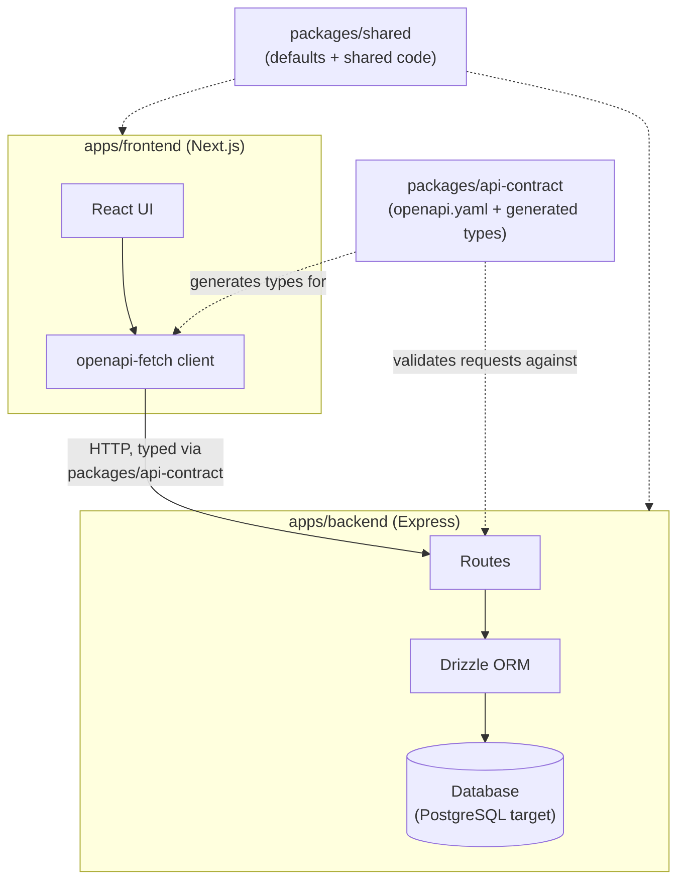

# Delegate History

Delegate History is a collaborative tool for reconstructing historical World Cube
Association (WCA) delegate records missing from the WCA website. It helps contributors
review and correct date histories using WCA reference data and historical evidence,
approve records, and prepare migration files for submission to WCA.

## Architecture

This repository is a pnpm workspace organized into applications and shared packages:

| Path                    | Purpose                                                                                         |
| ----------------------- | ----------------------------------------------------------------------------------------------- |
| `apps/backend`          | Express REST API. PostgreSQL is the local target; SQLite remains in the current implementation. |
| `apps/frontend`         | Next.js (App Router) React frontend styled with Tailwind CSS.                                   |
| `packages/api-contract` | OpenAPI specification and generated TypeScript API types.                                       |
| `packages/shared`       | Defaults and code shared across workspace applications.                                         |
| `docs`                  | Product planning, requirements, API endpoint, and data-type documentation.                      |

The frontend calls the backend using a typed client generated from the OpenAPI
contract. The backend currently exposes `GET /health`, which verifies that both the API
and database are available; the frontend's `/health` page displays that status.



- In development, the frontend and backend run as separate processes (`pnpm dev`)
  and talk over HTTP on `localhost`.
- `packages/api-contract`'s `openapi.yaml` is the source of truth for the API shape:
  it generates the frontend's typed client and validates every backend request/
  response at runtime (`express-openapi-validator`).

## Getting started

### Prerequisites

- Node.js 24.18.1
- pnpm 11.18.0

Install dependencies and start the backend and frontend development servers together:

```sh
pnpm install
pnpm dev
```

The backend listens on `http://127.0.0.1:3001` and the frontend on `http://localhost:3000`
by default; `pnpm dev` runs both concurrently and prints both URLs. Verify the backend
from another terminal:

```sh
curl http://127.0.0.1:3001/health
```

A healthy response is:

```json
{ "status": "ok", "database": "connected" }
```

Open `http://localhost:3000` in a browser to use the web app. Visit `/health` to see
whether the backend and database are connected.

The current backend creates a SQLite database at `.data/delegate-history.sqlite` by
default. PostgreSQL is the planned local development target; its migration is tracked
separately.

To run only one service, use `pnpm dev:backend` or `pnpm dev:frontend`.

## Commands

| Command             | Description                                                                |
| ------------------- | -------------------------------------------------------------------------- |
| `pnpm dev`          | Run the backend and frontend together in watch mode.                       |
| `pnpm dev:backend`  | Run only the backend in watch mode.                                        |
| `pnpm dev:frontend` | Run only the frontend in watch mode.                                       |
| `pnpm build`        | Build shared packages, generated API types, the backend, and the frontend. |
| `pnpm typecheck`    | Type-check every workspace package.                                        |
| `pnpm lint`         | Run ESLint across the repository.                                          |
| `pnpm test`         | Build the workspace and run backend and frontend tests.                    |
| `pnpm format`       | Format supported repository files with Prettier.                           |
| `pnpm format:check` | Check formatting without changing files.                                   |

## Configuration

The backend supports these environment variables:

| Variable             | Default                                        | Purpose                               |
| -------------------- | ---------------------------------------------- | ------------------------------------- |
| `HOST`               | `127.0.0.1`                                    | Address on which the backend listens. |
| `PORT`               | `3001`                                         | Backend HTTP port.                    |
| `FRONTEND_ORIGIN`    | `http://localhost:3000`                        | Origin allowed by CORS.               |
| `APP_DATA_DIRECTORY` | `.data`                                        | Directory for local application data. |
| `DATABASE_FILE`      | `<APP_DATA_DIRECTORY>/delegate-history.sqlite` | Current SQLite database path.         |

The frontend supports this environment variable:

| Variable                  | Default                 | Purpose                            |
| ------------------------- | ----------------------- | ---------------------------------- |
| `NEXT_PUBLIC_BACKEND_URL` | `http://127.0.0.1:3001` | Backend origin the frontend calls. |

## Project documentation

- [Product planning and tech stack](docs/planning.md)
- [Story index](docs/stories/README.md)
- [API endpoint index](docs/api-endpoints.md)
- [Data types and modeling decisions](docs/data-types.md)
- [Story requirements workflow](docs/story-requirements-workflow.md)
