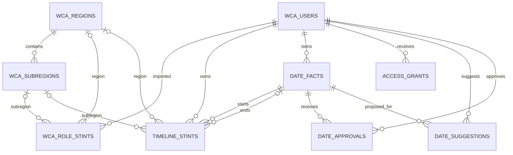

# Database Structure Mockup

**Status:** Draft for discovery  
**Last updated:** 2026-11-03

This is a conceptual first pass for discussion, not a finalized schema or migration
plan. It focuses on the local working dataset and review workflow. It does not attempt
to mirror WCA's full database.

## Design Principles

- Use WCA's `users.id` as the external identity key when it is available. Keep it
  distinct from the public WCA competitor ID (`wca_id`).
- Keep imported WCA state separate from editable local history. Import relevant WCA
  users, delegate region groups, and role rows directly into dedicated WCA mirror tables;
  do not use a generic `imported_rows` staging table.
- Seed `wca_users` from distinct `competition_delegates.delegate_id` values, users
  in `user_roles`, and spreadsheet Delegate IDs. Include delegates who have not yet
  delegated a competition.
- Represent each stint as a WCA-shaped row combining role and region/subregion.
  Regional and Senior rows have their own region scope and can overlap Delegate rows.
- Store each date once as an independently reviewable date fact. Adjacent stints can
  reference the same fact for the previous stint's end and the next stint's start. A
  local fact with a null date means a required date is missing. An active stint has no
  end-date fact. This differs from WCA's `user_roles.end_date = NULL` convention.
- Keep raw WCA dates in `wca_role_stints`; `date_facts` are for locally imported,
  suggested, or reviewed history and are not the WCA snapshot.
- Preserve the agreed date metadata: one optional source value, an approximate-date
  boolean, and notes. Approximate ranges stay in notes until the working group chooses
  one date in the UI; unresolved ranges cannot generate WCA migration entries.
- Public users can read without authentication. WCA-authenticated admins, approvers, and
  suggestors have distinct permissions.
- The current export is authoritative for dates already in WCA. Spreadsheet entries are
  still kept locally even when a matching WCA date suppresses a duplicate migration.

## Relationship Sketch

Relevant WCA data is upserted into WCA mirror tables, retaining source IDs and raw
values. Spreadsheet and team-authored dates go into the separate local timeline/date
tables. The two sets are compared during sync; local input never overwrites the WCA
snapshot. A local stint may optionally reference a matched WCA role row after matching.
Adjacent local stints may share one canonical date fact at their transition. The exact
migration file format remains deferred until the WCA migration contract is inspected.

## Proposed Tables

### Canonical identity

`wca_users.id` is the canonical identity key for everyone in the application. Do not
create a separate local `people` table or duplicate WCA names/IDs locally. Unmatched
spreadsheet IDs and ID/name conflicts are reviewed during import.

### WCA mirror tables: `wca_users`, `wca_regions`, `wca_subregions`, `wca_role_stints`

These are read-only application mirrors updated by WCA sync. Import only relevant user
fields; do not copy private account fields such as email addresses or credentials.

| Table             | Candidate fields                                                                                                  |
| ----------------- | ----------------------------------------------------------------------------------------------------------------- |
| `wca_users`       | WCA `id` as PK, `wca_id`, `name`, `synced_at`.                                                                    |
| `wca_regions`     | WCA group ID, name, active/hidden flags.                                                                          |
| `wca_subregions`  | WCA group ID, parent `wca_region_id`, name, active/hidden flags.                                                  |
| `wca_role_stints` | WCA role row ID, user ID, role status, region/subregion IDs, raw start/end dates, selected metadata, `synced_at`. |

Import regions/subregions from `user_groups.group_type = 'delegate_regions'`, preserving
WCA group IDs and `parent_group_id`. Import role data from `user_roles` with its delegate
metadata and map `group_id` to the corresponding WCA-backed region/subregion. Confirm
the precise parent/child mapping during import; exclude unrelated groups.

`wca_role_stints` is a read-only mirror of relevant `user_roles` rows and delegate
metadata. Upsert it during sync; do not edit it through the local history UI.

| Column                                                                      | Purpose                                                           |
| --------------------------------------------------------------------------- | ----------------------------------------------------------------- |
| `wca_user_role_id`                                                          | WCA `user_roles.id`, primary key for the imported role.           |
| `wca_user_id`                                                               | FK to `wca_users.id`.                                             |
| `role_type`                                                                 | Imported role status such as `delegate` or `regional_delegate`.   |
| `region_id`, `subregion_id`                                                 | WCA-backed region lookup IDs resolved from `user_roles.group_id`. |
| `start_date`, `end_date`                                                    | Raw WCA dates; null `end_date` means active in WCA.               |
| `metadata_location`, `first_delegated`, `last_delegated`, `total_delegated` | Selected WCA metadata fields useful for comparison.               |
| `synced_at`                                                                 | When this WCA role row was last refreshed.                        |

Do not copy unrelated user rows or private account fields such as emails or credentials.

### `access_grants`

WCA-authenticated people granted application roles. Public read access does not require
a row here.

| Column                     | Purpose                                                  |
| -------------------------- | -------------------------------------------------------- |
| `id`                       | Local primary key.                                       |
| `wca_user_id`              | FK to the authenticated `wca_users.id` receiving access. |
| `role`                     | `admin`, `approver`, or `suggestor`.                     |
| `granted_by_wca_user_id`   | Admin who granted the role.                              |
| `created_at`, `revoked_at` | Grant/revocation audit timestamps.                       |

Admins manage grants. Working-group members are approvers who can edit dates and approve
them. Invited suggestors can submit date suggestions with a required explanatory comment;
an approver accepts or rejects each suggestion.

### `timeline_stints`

One WCA-shaped role stint. Delegate-track stints combine rank with the delegate's
region/subregion. Regional/Senior stints reference their own region/subregion, which is
the role's scope rather than the person's delegate location.

| Column                     | Purpose                                                                                                                            |
| -------------------------- | ---------------------------------------------------------------------------------------------------------------------------------- |
| `id`                       | Local primary key.                                                                                                                 |
| `wca_user_id`              | FK to `wca_users.id` for the person whose history this represents.                                                                 |
| `role_type`                | Candidate values: `trainee_delegate`, `junior_delegate`, `delegate`, `regional_delegate`, `senior_delegate`, `temporary_delegate`. |
| `region_id`                | FK to `wca_regions` for this locally authored stint, when applicable.                                                              |
| `subregion_id`             | FK to `wca_subregions` for this locally authored stint, when applicable.                                                           |
| `matched_wca_role_id`      | Optional FK to `wca_role_stints.wca_user_role_id` after sync confirms a match.                                                     |
| `start_date_fact_id`       | Required FK to the canonical start date fact. A missing required start uses a fact with a null `date_value`.                       |
| `end_date_fact_id`         | Nullable FK to the canonical end date fact. Null FK means active; a linked fact with a null `date_value` means end date missing.   |
| `notes`                    | Context not represented by the structured fields.                                                                                  |
| `created_at`, `updated_at` | Local audit timestamps.                                                                                                            |

Role vocabulary and region/subregion mapping are provisional. First/last competition
dates may be represented as separate activity records rather than role stints.

### `date_facts`

One canonical row per date fact so each date can have its own confidence, source, and
approval. A fact is not owned by one stint: for a promotion or location change, the same
fact ID can be used as the prior stint's `end_date_fact_id` and the next stint's
`start_date_fact_id`. This avoids duplicating a transition date.

| Column           | Purpose                                                                                 |
| ---------------- | --------------------------------------------------------------------------------------- |
| `id`             | Local primary key.                                                                      |
| `wca_user_id`    | FK to `wca_users.id` for the person whose history the date belongs to.                  |
| `date_value`     | Date value; null means the date is known to be required but is missing.                 |
| `is_approximate` | Boolean quality marker.                                                                 |
| `source`         | Optional single source value; combobox can select an existing value or accept new text. |
| `notes`          | May preserve an approximate range or exceptional context.                               |
| `created_at`     | Record creation timestamp; actor attribution is not stored here.                        |

A date fact's meaning comes from the timeline stint boundary that references it (`start`
or `end`) and, for shared transition dates, the adjacent stints. Unusual context belongs
in `notes` rather than a duplicated event-type field. Derive its current review state
from its approval records instead of storing a redundant `review_state`.

Keep `wca_user_id` on the date fact as its owner, even though it can usually be reached
through a referencing stint. A fact may be created or reviewed before it is attached to
all of its stints, and its person should remain unambiguous. The application must ensure
that any stints sharing a fact belong to that same WCA user.

For an active local stint, leave `end_date_fact_id` null. Do not create an end-date fact
with a null date to mean active. A linked fact with `date_value = NULL` instead means a
required date is missing. An approximate range remains in notes and is not migration-
ready until the working group chooses one date. A WCA migration row contains one date
per entry.

### `date_suggestions`

Pending date proposals from suggestors. Suggestions do not have approvals. When an
approver accepts a proposal, promote its proposed value and evidence into the canonical
`date_fact`; approvers then approve that date fact. The suggestion itself is not an
approval target.

| Column                     | Purpose                                                                      |
| -------------------------- | ---------------------------------------------------------------------------- |
| `id`                       | Local primary key.                                                           |
| `date_fact_id`             | Required FK to the date fact being proposed or corrected.                    |
| `proposed_date`            | Proposed single date value.                                                  |
| `is_approximate`, `source` | Proposed date quality and source value.                                      |
| `comment`                  | Required explanation, such as the email/source and why it supports the date. |
| `suggested_by_wca_user_id` | Invited WCA-authenticated suggestor.                                         |
| `created_at`               | Suggestion submission timestamp.                                             |

Suggestion acceptance promotes the proposal into a `date_fact`; the date fact's approval
records then determine its review state. How to dismiss or retain unaccepted suggestions
is still to be decided.

### `date_approvals`

One approval record per approver and canonical date fact, allowing multiple approvers
to approve the same fact. Suggestions are promoted to date facts before they can receive
approvals.

| Column                 | Purpose                                   |
| ---------------------- | ----------------------------------------- |
| `id`                   | Local primary key.                        |
| `date_fact_id`         | Required FK to the approved date fact.    |
| `approver_wca_user_id` | WCA-authenticated working-group approver. |
| `created_at`           | Approval timestamp.                       |

Current approval state is derived from its approval records; the required approval
threshold and handling of changing or revoking approvals remain open.

## Example Mapping

The proposed example maps to WCA-shaped stints with shared date facts as follows:

| Stint | Role type       | Region | Subregion | Start fact | End fact        |
| ----- | --------------- | ------ | --------- | ---------- | --------------- |
| 1     | Junior Delegate |        | Georgia   | 1          | 2               |
| 2     | Delegate        |        | Georgia   | 2          | Active (`NULL`) |
| 3     | Regional        |        | Southeast | 3          | 4               |
| 4     | Regional        |        | Southeast | 5          | Active (`NULL`) |

| Date fact | Date value | Meaning                                                             |
| --------- | ---------- | ------------------------------------------------------------------- |
| 1         | 2016-08-05 | Junior stint starts                                                 |
| 2         | 2017-08-06 | Junior ends and Delegate starts; one shared fact                    |
| 3         | 2018-10-01 | Regional stint starts                                               |
| 4         | 2020-06-23 | Regional stint ends and next one starts; one shared fact            |
| 5         | 2021-07-14 | Not referenced by the four stints shown; intended event is unclear. |

The example's fifth date fact is not linked to any listed stint; clarify its intended
event before using it as a migration example. A single `date_facts` row can be referenced
by both an ending stint and the next starting stint. Senior/Regional stints remain
independent of delegate-track location changes. Shared boundary dates are provisionally
inclusive on both adjacent rows, matching the observed WCA date pattern.

## Deferred Schema Decisions

- Exact event/track vocabulary and whether promotions/demotions are explicit event types
  or inferred from adjacent rank stints.
- How to persist a selected/filter-based migration generation run. The file format and
  post-generation WCA workflow are out of current scope.
- Detailed sync reconciliation and conflict resolution, deferred until a baseline app
  exists.
- Exact direct-import/upsert and re-import/idempotency behavior for WCA users, roles, and
  region/subregion records.
- WCA authentication implementation and claim mapping. Inspect
  `southeastcubing.org` when auth work begins.

This mockup should be reviewed against the spreadsheet, WCA export, and eventual WCA
migration contract before it becomes an implementation schema.
